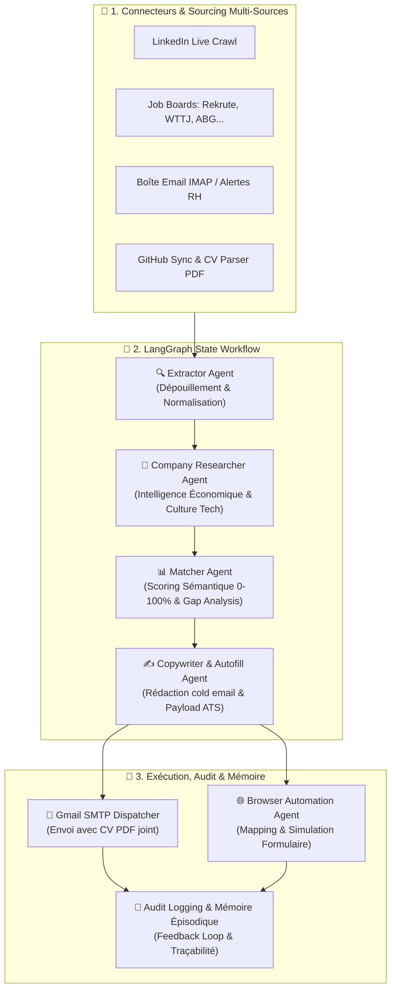

# 🎯 PFE AI Job Hunter — Autonomous Multi-Agent Career Copilot

[](https://www.python.org/)
[](https://github.com/langchain-ai/langgraph)
[](https://fastapi.tiangolo.com/)
[](https://ai.google.dev/)
[](LICENSE)

**PFE AI Job Hunter** est une plateforme autonome d'agents d'intelligence artificielle conçue pour automatiser, orchestrer et hyper-personnaliser la recherche de stages de fin d'études (PFE) et d'opportunités d'ingénierie en Data, Intelligence Artificielle et Software Engineering.

Grâce à une architecture en graphe d'états (**LangGraph**) et un écosystème de connecteurs multi-sources, l'agent veille en continu, analyse sémantiquement les offres, mène des recherches d'intelligence sur les entreprises cibles, et génère des candidatures sur-mesure prêtes à l'envoi.

---

## 🏗️ Architecture du Système Multi-Agent

Le projet repose sur une synergie d'agents spécialisés coordonnés à la fois en pipeline direct et via un graphe d'états réactif :



---

## ✨ Fonctionnalités Clés

### 1. 🔍 Détection Multi-Canale & Scraping Intelligent
- **LinkedIn Connector** : Détection en temps réel des publications de recrutement et mots-clés (`#STAGE_PFE`, `#RECRUTEMENT`).
- **Job Boards Crawlers** : Scan des plateformes d'emploi (Rekrute, Welcome to the Jungle, Dreamjob, ABG, Emploi.ma).
- **Email Lead Scanner** : Analyse des alertes reçues dans votre boîte de messagerie via protocole IMAP.
- **GitHub Sync** : Synchronisation automatique des projets publics et stacks technologiques pour enrichir votre portfolio.
- **CV Parser PDF** : Extraction instantanée des compétences, formations et réalisations depuis un CV au format PDF.

### 2. 🧠 Pipeline LangGraph & Intelligence Économique
- **Extractor Agent** : Extraction structurée des entités (contacts RH/CTO, intitulé exact, stack exigée, localisation).
- **Researcher Agent** : Génération d'une fiche d'intelligence sur l'entreprise (secteur, culture technique, actualités, conseils pour l'entretien).
- **Semantic Matcher** : 
  - Calcul d'un score de pertinence objectif (0 à 100%).
  - Alignement point par point entre exigences de l'offre et compétences du candidat.
  - Sélection automatique du meilleur projet du portfolio à valoriser.
- **Copywriter Agent** : Rédaction d'e-mails d'approche directe ultra-personnalisés selon la structure : *Accroche ciblée $\rightarrow$ Preuve de valeur technique $\rightarrow$ Appel à l'action précis*.
- **Autofill Agent** : Préparation de formulaires d'auto-remplissage pour portails ATS d'entreprises.

### 3. ⚡ Dispatch Réel & Dashboard Web Interactif
- **FastAPI Backend & Dashboard Web** : Interface graphique moderne et réactive pour piloter la veille, visualiser les métriques, ajuster les candidatures et suivre leur statut.
- **Envoi Réel SMTP** : Expédition directe des candidatures depuis votre boîte Gmail avec votre CV PDF en pièce jointe.
- **Scheduler Autonome** : Démon d'arrière-plan programmable pour surveiller les opportunités 24/7 selon vos filtres (`search_config.json`).
- **Traçabilité & Mémoire Épisodique** : Historique complet des actions d'audit et apprentissage contextuel basé sur les retours d'expériences.

---

## 🛠️ Stack Technologique

| Composant | Technologie |
| :--- | :--- |
| **Framework Multi-Agent** | [LangGraph](https://github.com/langchain-ai/langgraph), [LangChain Core](https://python.langchain.com/) |
| **Moteurs LLM** | Google Gemini (prioritaire) & NVIDIA NIM (Llama 3.3 70B, Mistral, DeepSeek) |
| **API & Serveur Web** | [FastAPI](https://fastapi.tiangolo.com/), Uvicorn, Pydantic V2 |
| **Interface Frontend** | HTML5, CSS3 Moderne (Glassmorphism), Vanilla JavaScript |
| **Extraction & Parsing** | PyPDF, DuckDuckGo Search Live API |
| **Messagerie & Envoi** | Python IMAP / SMTP SSL Sécurisé |
| **CLI & Affichage Terminal** | Rich Console |

---

## 📁 Structure du Projet

```text
pfe-job-hunter/
│
├── agents/                       # Écosystème d'agents autonomes
│   ├── extractor.py              # Extraction d'opportunités depuis du texte brut
│   ├── researcher.py             # Veille économique et analyse d'entreprise
│   ├── matcher.py                # Scoring sémantique offre vs candidat
│   ├── copywriter.py             # Rédaction d'e-mails à forte conversion
│   ├── autofill.py               # Génération de payloads pour formulaires
│   ├── cv_parser.py              # Analyseur de CV PDF
│   ├── github_connector.py       # Synchronisation des dépôts GitHub du candidat
│   ├── linkedin_connector.py     # Scan des posts et fils d'actualité LinkedIn
│   ├── jobboard_connector.py     # Crawl des job boards spécialisés
│   ├── email_connector.py        # Lecture IMAP et envoi SMTP réel (Gmail)
│   ├── searcher.py               # Moteur de recherche live multi-critères
│   ├── web_search_engine.py      # Couche d'interaction moteur de recherche
│   ├── browser_automation.py     # Automatisation et simulation de formulaires
│   ├── verifier.py               # Vérification de soumission & mémoire épisodique
│   └── tailor_agent.py           # Raffinement dynamique des candidatures
│
├── static/                       # Frontend Dashboard Web
│   ├── index.html                # Tableau de bord utilisateur
│   ├── app.js                    # Logique cliente & interactions API
│   └── style.css                 # Thème & design moderne
│
├── config.py                     # Initialisation des providers LLM (Gemini / NVIDIA)
├── graph.py                      # Définition du graphe d'états LangGraph
├── models.py                     # Schémas et validation Pydantic V2
├── server.py                     # Serveur d'application FastAPI
├── scheduler.py                  # Service d'exécution planifiée en arrière-plan
├── storage.py                    # Gestionnaire de persistance et journaux d'audit
├── main.py                       # Interface utilisateur CLI (Rich)
├── profile_data.json             # Profil technique et portfolio du candidat
├── search_config.json            # Configuration des critères de recherche et veille
├── requirements.txt              # Dépendances Python du projet
└── .env.example                  # Modèle de variables d'environnement
```

---

## 🚀 Installation & Démarrage Rapide

### 1. Prérequis
- Python 3.10 ou version supérieure
- Un compte [Google AI Studio](https://aistudio.google.com/) (pour clé API Gemini gratuite) ou [NVIDIA Build](https://build.nvidia.com/)

### 2. Cloner le dépôt et installer les dépendances

```bash
git clone https://github.com/Yousra-khallou/pfe-job-hunter.git
cd pfe-job-hunter

# Création d'un environnement virtuel (recommandé)
python -m venv .venv

# Activation :
# Sur Windows :
.venv\Scripts\activate
# Sur Linux/macOS :
source .venv/bin/activate

# Installation des paquets
pip install -r requirements.txt
```

### 3. Configuration des variables d'environnement

Copiez le fichier exemple :
```bash
cp .env.example .env
```

Éditez le fichier `.env` avec vos clés :
```env
# Provider LLM (Google Gemini recommandé)
LLM_PROVIDER=gemini
GEMINI_API_KEY=AIzaSy...votre-cle-api-gemini
GEMINI_MODEL=gemini-2.5-flash

# Optionnel : Expédition réelle d'e-mails via Gmail
GMAIL_USER=votre.email@gmail.com
GMAIL_APP_PASSWORD=xxxx-xxxx-xxxx-xxxx
```

---

## 💻 Utilisation

### Mode 1 : Tableau de bord Web interactif (Recommandé)

Lancez le serveur FastAPI :
```bash
python server.py
```
Ouvrez ensuite votre navigateur sur **[http://localhost:8000](http://localhost:8000)** pour accéder à l'interface complète :
- Visualisez les métriques et statistiques de vos démarches.
- Lancez des scans d'offres en direct sur LinkedIn et les Jobboards.
- Ajustez ou importez votre CV au format PDF en un clic.
- Évaluez le score de correspondance et révisez les e-mails générés avant leur envoi SMTP.

---

### Mode 2 : Mode CLI (Terminal interactif)

Pour une utilisation légère ou scriptée en ligne de commande :
```bash
python main.py
```

---

## 🔒 Confidentialité & Bonnes Pratiques

- **Protection des secrets** : Les fichiers d'environnement (`.env`), les bases de données d'exécution locales (`candidatures_db.json`, `audit_logs.json`) et les documents personnels (`Applications/*.pdf`) sont exclus par défaut du versioning grâce au fichier `.gitignore`.
- **Validation humaine (Human-in-the-Loop)** : Le système permet à l'utilisateur de réviser et valider chaque candidature générée avant tout déclenchement d'envoi réel.

---

## 📄 Licence

Ce projet est sous licence [MIT](LICENSE).
