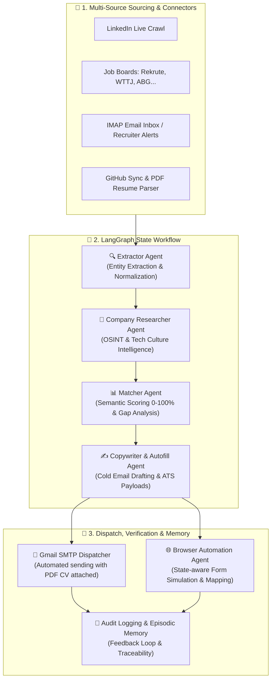

# 🎯 PFE AI Job Hunter — Autonomous Multi-Agent Career Copilot

[](https://www.python.org/)
[](https://github.com/langchain-ai/langgraph)
[](https://fastapi.tiangolo.com/)
[](https://ai.google.dev/)
[](LICENSE)

**PFE AI Job Hunter** is an autonomous multi-agent AI system engineered to discover, score, tailor, and dispatch end-of-studies engineering internships (PFE) and tech job applications.

Powered by a reactive state graph (**LangGraph**) and an ecosystem of multi-source connectors, the agent runs continuous market surveillance, performs semantic matching against candidate profiles, conducts automated company OSINT, and drafts high-conversion outreach emails and ATS form payloads ready for dispatch.

---

## 🏗️ Multi-Agent Architecture

The system coordinates specialized autonomous sub-agents through both independent background workers and an orchestrated **LangGraph StateGraph** pipeline:



---

## ✨ Key Features

### 1. 🔍 Multi-Channel Lead Discovery & Real-Time Crawling
- **LinkedIn Connector**: Scrapes live posts and recruitment feeds targeting hashtags (`#STAGE_PFE`, `#RECRUTEMENT`, `#HIRING`).
- **Job Board Crawlers**: Scrapes Moroccan and European platforms (Rekrute, Welcome to the Jungle, Dreamjob, ABG, Emploi.ma).
- **Email Lead Scanner**: Parses incoming job alerts and inbound recruiter emails via secure IMAP.
- **GitHub Sync**: Connects to the candidate's GitHub profile to automatically import repositories, tech stacks, and project highlights into the portfolio.
- **PDF Resume Parser**: Parses and extracts candidate skills, experience, and education from a PDF resume using `pypdf`.

### 2. 🧠 LangGraph Pipeline & Company Intelligence
- **Extractor Agent**: Extracts structured target records (hiring manager/CTO contacts, exact title, tech requirements, location, context).
- **Researcher Agent**: Gathers corporate intelligence (industry sector, engineering culture, recent news, interview strategies).
- **Semantic Matcher**:
  - Computes an objective alignment score (0–100%).
  - Performs requirement-by-requirement gap analysis against the candidate's background.
  - Automatically selects the most relevant portfolio project to emphasize.
- **Copywriter Agent**: Crafts concise, tailored outreach emails following a proven technical conversion framework (*Hook $\rightarrow$ Proof of Value $\rightarrow$ Clear Call-to-Action*).
- **Autofill Agent**: Pre-fills structured key-value payloads formatted for standard ATS portals (Workday, Lever, Greenhouse).

### 3. ⚡ Real Dispatch & Interactive Web Dashboard
- **FastAPI Backend & Web Dashboard**: Clean modern UI for real-time surveillance, metrics monitoring, application reviews, and status tracking.
- **Direct SMTP Dispatch**: Sends live emails directly via secure Gmail SMTP with candidate CV dynamically attached.
- **Autonomous Background Scheduler**: Daemon thread that triggers periodic scans according to customizable parameters (`search_config.json`).
- **Traceability & Episodic Memory**: Audit trail of every agent action and episodic learning loop that refines subsequent applications.

---

## 🛠️ Tech Stack

| Category | Technology |
| :--- | :--- |
| **Agent Orchestration** | [LangGraph](https://github.com/langchain-ai/langgraph) (StateGraph), [LangChain Core](https://python.langchain.com/) |
| **LLM Engines** | Google Gemini (Primary via OpenAI-compatible endpoint) & NVIDIA NIM (Fallback: Llama 3.3 70B, Mistral, DeepSeek) |
| **Backend & REST API** | [FastAPI](https://fastapi.tiangolo.com/), Uvicorn, Pydantic V2 |
| **Frontend Dashboard** | Modern Responsive UI (Glassmorphism, Vanilla JS, CSS3) |
| **Parsing & Search Engines** | PyPDF, DuckDuckGo Search Live API |
| **Email Protocol** | Python IMAP / SSL SMTP |
| **CLI & Formatting** | Rich Console |

---

## 📁 Repository Structure

```text
pfe-job-hunter/
│
├── agents/                       # Specialized autonomous sub-agents
│   ├── extractor.py              # Lead entity extraction from raw text
│   ├── researcher.py             # Company OSINT and business intelligence
│   ├── matcher.py                # Semantic offer-candidate compatibility scoring
│   ├── copywriter.py             # High-conversion technical email generator
│   ├── autofill.py               # ATS form payload generator
│   ├── cv_parser.py              # PDF resume parser
│   ├── github_connector.py       # GitHub repository synchronizer
│   ├── linkedin_connector.py     # Live LinkedIn post scraper
│   ├── jobboard_connector.py     # Specialized job board crawlers
│   ├── email_connector.py        # IMAP inbox scanner & real SMTP sender
│   ├── searcher.py               # Multi-criteria search orchestrator
│   ├── web_search_engine.py      # DuckDuckGo live search client & parser
│   ├── browser_automation.py     # State-aware form mapping & browser simulator
│   ├── verifier.py               # Dispatch verification & episodic memory
│   └── tailor_agent.py           # Dynamic candidate profile personalizer
│
├── static/                       # Web Dashboard frontend assets
│   ├── index.html                # Application control center UI
│   ├── app.js                    # Client-side reactivity & API client
│   └── style.css                 # Modern responsive styling
│
├── config.py                     # LLM provider initialization (Gemini / NVIDIA)
├── graph.py                      # LangGraph StateGraph workflow definition
├── models.py                     # Pydantic V2 models & state schemas
├── server.py                     # FastAPI application & entrypoint
├── scheduler.py                  # Background periodic surveillance scheduler
├── storage.py                    # Persistence manager & audit logger
├── main.py                       # Interactive CLI interface (Rich)
├── profile_data.json             # Candidate profile & project portfolio
├── search_config.json            # Target criteria & scraping configuration
├── requirements.txt              # Python dependencies
└── .env.example                  # Environment configuration template
```

---

## 🚀 Quickstart

### 1. Prerequisites
- Python 3.10+
- A [Google AI Studio API Key](https://aistudio.google.com/) (Gemini) or a [NVIDIA Build API Key](https://build.nvidia.com/)

### 2. Clone Repository & Install Dependencies

```bash
git clone https://github.com/Yousra-khallou/pfe-job-hunter.git
cd pfe-job-hunter

# Create virtual environment
python -m venv .venv

# Activate environment:
# Windows (PowerShell):
.venv\Scripts\Activate.ps1
# Linux / macOS:
source .venv/bin/activate

# Install dependencies
pip install -r requirements.txt
```

### 3. Environment Variables Configuration

Copy the sample environment file:
```bash
cp .env.example .env
```

Edit `.env` with your API credentials:
```env
# Primary LLM Provider (Google Gemini recommended)
LLM_PROVIDER=gemini
GEMINI_API_KEY=AIzaSy...your-gemini-key
GEMINI_MODEL=gemini-2.5-flash

# Optional: Real Gmail Outbound Email Sending
GMAIL_USER=your.email@gmail.com
GMAIL_APP_PASSWORD=xxxx-xxxx-xxxx-xxxx
```

---

## 💻 Running the Application

### Option 1: Web Dashboard (Recommended)

Start the FastAPI application:
```bash
python server.py
```
*(Or with live-reload: `uvicorn server:app --reload --port 8000`)*

Navigate to **[http://localhost:8000](http://localhost:8000)** in your browser:
- Trigger multi-channel scrapers on demand (**LinkedIn**, **Job Boards**, **Inbox**).
- Upload and inspect PDF resumes with automatic parameter extraction.
- Review semantic scores and customize generated emails before triggering SMTP dispatch.
- Supervise background surveillance tasks and inspect episodic memory logs.

---

### Option 2: Interactive Terminal CLI

Run the command-line interface:
```bash
python main.py
```

---

### Option 3: Manual API / Headless Trigger

Trigger a full multi-connector scrape and LangGraph workflow via REST API:
```bash
curl -X POST http://localhost:8000/api/connectors/scan-all
```

Run standalone search engine diagnostics:
```bash
python test_live_search.py
```

---

## 🔒 Security & Privacy

- **Secret Isolation**: Sensitive API credentials (`.env`), runtime databases (`candidatures_db.json`), audit logs (`audit_logs.json`), and personal CV files (`Applications/*.pdf`) are excluded from version control via [`.gitignore`](.gitignore).
- **Human-in-the-Loop Safeguards**: The system does not dispatch external emails without candidate review and confirmation.

---

## 📄 License

Distributed under the [MIT](LICENSE) License.
